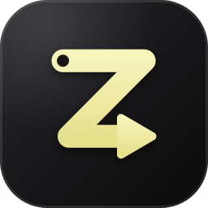
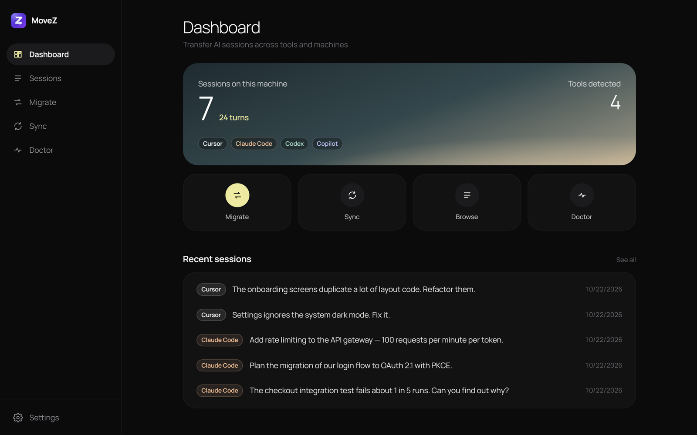
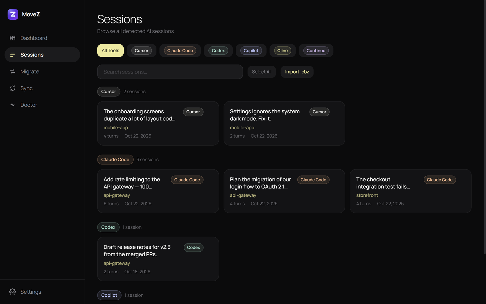
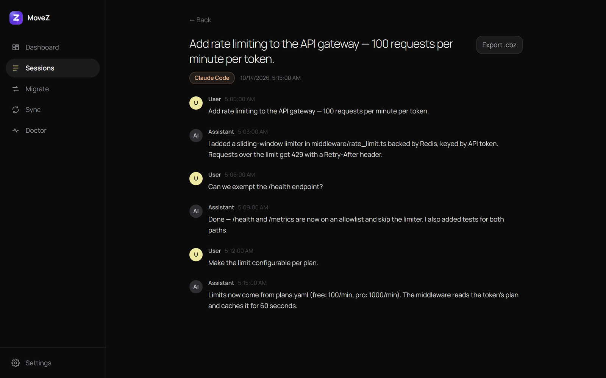
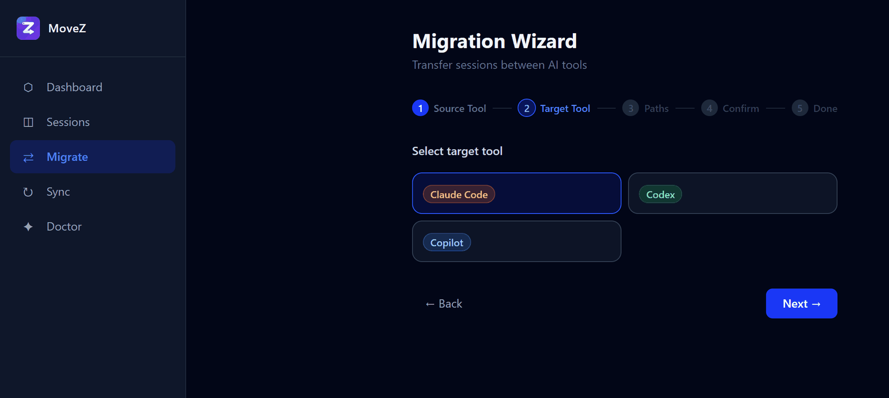

<p align="center">
  
</p>

<h1 align="center">MoveZ</h1>

<p align="center">
  <strong>Your AI coding sessions, anywhere you work.</strong><br>
  Move conversations between Cursor, Claude Code, Codex, Copilot CLI, Cline and Continue — and between machines.
</p>

<p align="center">
  <a href="https://github.com/kv4u/MoveZ/releases/latest"></a>
  <a href="https://github.com/kv4u/MoveZ/actions/workflows/ci.yml"></a>
  
  <a href="LICENSE"></a>
</p>

<p align="center">
  <a href="https://kv4u.github.io/MoveZ/"><strong>Website</strong></a> ·
  <a href="https://github.com/kv4u/MoveZ/releases/latest"><strong>Download</strong></a> ·
  <a href="#quick-start">Quick start</a> ·
  <a href="docs/sync-server-setup.md">Sync server</a> ·
  <a href="docs/extension-setup.md">VS Code extension</a>
</p>

<p align="center">
  
</p>

---

Your conversations with AI coding assistants hold real project context: decisions, dead ends, explanations. Switching editors or laptops usually means losing all of it. **MoveZ** reads the sessions every supported tool stores on your machine and moves them where you need them.

- 🔁 **Transfer between tools** — copy a Cursor session into Claude Code, Codex or Copilot CLI in one step.
- 💻 **Move to a new machine** — export a portable `.cbz` bundle and import it anywhere, with project paths remapped (`D:\Projects` → `~/work`).
- 🔒 **Encrypted end to end** — AES-256-GCM before anything leaves your machine; your key never does.
- ☁️ **Self-hosted sync** — push and pull between machines through your own server, which only stores ciphertext.
- 🧩 **Desktop, CLI or editor** — a desktop app for Windows, macOS and Linux, a single-file CLI, and a VS Code / Cursor extension.
- 📁 **Project config travels too** — optionally bundle `CLAUDE.md`, `AGENTS.md`, `.cursorrules` and `.mcp.json`.

No telemetry, no accounts, no cloud you don't run yourself.

## Download

Get everything from the [latest release](https://github.com/kv4u/MoveZ/releases/latest):

| Platform | File | Notes |
|---|---|---|
| **Windows** | `MoveZ-Setup-<version>.exe` | Bundles PHP and the CLI |
| **macOS** (Apple Silicon) | `MoveZ-<version>-mac-arm64.dmg` | Unsigned: right-click → **Open** the first time |
| **macOS** (Intel) | `MoveZ-<version>-mac-x64.dmg` | Unsigned: right-click → **Open** the first time |
| **Linux** (x86-64) | `MoveZ-<version>-linux-x86_64.AppImage` | `chmod +x`, then run |
| **CLI** (any OS) | `movez.phar` | PHP 8.2+ with `pdo_sqlite`, `openssl`, `zip`, `mbstring` |
| **VS Code / Cursor** | `movez-vscode.vsix` | Extensions → **Install from VSIX…**; needs the CLI |

<details>
<summary><strong>Install the CLI</strong></summary>

```bash
curl -L https://github.com/kv4u/MoveZ/releases/latest/download/movez.phar -o movez
chmod +x movez && sudo mv movez /usr/local/bin/movez
movez doctor     # checks PHP, extensions, your key, and which AI tools it finds
```

On Windows, run it through PHP: `php movez.phar doctor`.
</details>

## Quick start

**In the desktop app:** open **Migrate**, pick a source and a target tool, and run it. Or open **Sessions**, select some, and export them to a `.cbz` bundle.

**On the command line:**

```bash
# What's on this machine?
movez list-sessions

# Copy this project's Cursor sessions into Claude Code
movez transfer --from=cursor --to=claude-code --project=.

# Back up to an encrypted bundle…
movez export --tool=claude-code --output=work.cbz --encrypt

# …and restore it on a new machine, fixing paths
movez key:import --file=movez.key
movez import --input=work.cbz --tool=claude-code \
  --from-path="D:/Projects" --to-path="~/work"
```

`--project` limits a command to one project's sessions; leave it out to include all of them.

## Screenshots

<table>
  <tr>
    <td width="50%"><p align="center"><sub>Every tool's sessions, grouped and searchable</sub></p></td>
    <td width="50%"><p align="center"><sub>Read full conversations and export them</sub></p></td>
  </tr>
  <tr>
    <td colspan="2" align="center"><p align="center"><sub>Tool-to-tool migration with optional path remapping</sub></p></td>
  </tr>
</table>

## Supported tools

| Tool | Read | Write | Where it lives |
|---|:---:|:---:|---|
| Cursor | ✅ | ✅ | `~/.cursor/projects` transcripts + `state.vscdb` |
| Claude Code | ✅ | ✅ | `~/.claude/projects/*.jsonl` (+ Claude desktop app registry) |
| Codex CLI | ✅ | ✅ | `~/.codex/sessions/YYYY/MM/DD/rollout-*.jsonl` |
| Copilot CLI | ✅ | ✅ | `~/.copilot/session-state/<id>/` |
| Cline | ✅ | — | VS Code extension task history |
| Continue | ✅ | — | `~/.continue/sessions/*.json` |
| Windsurf | — | — | Not yet: Cascade stores conversations in an encrypted format |

<details>
<summary><strong>Tool-specific notes</strong> (Cursor, Claude Code, Copilot CLI)</summary>

**Cursor** only shows sessions for workspaces it already knows. Open the target project in Cursor once and quit it completely, then import and reopen Cursor. The full history is visible, but Cursor's internal model state can't be recreated, so to continue a conversation start a new chat and reference the old one.

**Claude Code** sessions are written under `~/.claude/projects/<encoded-path>/`. On Windows they're also registered with the Claude desktop app so they appear in its history. Re-importing updates a session instead of duplicating it.

**Copilot CLI** keeps a search index of sessions. If imported sessions don't appear in its history, run `/chronicle reindex` inside Copilot CLI.
</details>

## Sync between machines

1. **Run a sync server** — see [docs/sync-server-setup.md](docs/sync-server-setup.md) — and create your account and token:
   ```bash
   php artisan movez:user you@example.com
   php artisan movez:token you@example.com
   ```
2. **Configure each machine** (environment variables keep the token out of process lists):
   ```bash
   export MOVEZ_SERVER_URL=https://sync.example.com
   export MOVEZ_TOKEN=<token>                          # or save it in ~/.movez/token
   ```
3. **Share the encryption key** — every machine you pull on needs the same one:
   ```bash
   movez key:export | ssh machine-b movez key:import   # or key:export > file, key:import --file=file
   movez key:fingerprint                               # must match on both machines
   ```
4. **Push and pull:**
   ```bash
   movez sync:push --tool=claude-code                  # machine A
   movez sync:pull --tool=claude-code                  # machine B
   ```

The sync server also serves a web dashboard (sign-in required, no public registration) where each user sees their own projects and sessions.

## Reference

<details>
<summary><strong>All CLI commands</strong></summary>

| Command | What it does | Key options |
|---|---|---|
| `list-sessions` | List detected sessions | `--tool`, `--project`, `--json` |
| `show` | Print one session with all turns | `--tool`, `--id`, `--json` |
| `export` | Write sessions to a `.cbz` bundle (or `.json`) | `--tool`, `--output`, `--project`, `--encrypt`, `--with-config` |
| `import` | Load a bundle into a tool | `--input`, `--tool`, `--project`, `--from-path`, `--to-path`, `--with-config` |
| `transfer` | Export + import in one step | `--from`, `--to`, `--project`, `--from-path`, `--to-path` |
| `package` / `unpack` | Convert between `.json` session lists and `.cbz` | `--input`, `--output`, `--encrypt` |
| `sync:push` / `sync:pull` | Encrypted sync through your server | `--server`, `--tool`, `--project` |
| `key:export` / `key:import` | Move the encryption key between machines | `--output` / `--file`, `--force` |
| `key:fingerprint` | Non-secret fingerprint to compare machines | |
| `doctor` | Check requirements and detected tools | |

Run `movez <command> --help` for every option.
</details>

<details>
<summary><strong>Bundle format (<code>.cbz</code>)</strong></summary>

A `.cbz` is a ZIP archive:

| File | Contents |
|---|---|
| `bundle.json` | `{ version, source_tool, exported_at, sessions: [...] }` — encrypted when `manifest.encrypted` is true |
| `manifest.json` | `{ version, source_tool, machine_sha, exported_at, session_count, encrypted }` |
| `config.json` | Optional project config, written by `export --with-config` |

Each session has `id, title, project, source_tool, created_at, last_active_at, turn_count, turns[]`; each turn has `role, content, timestamp`. Encrypted data is `base64(iv[12] ‖ tag[16] ‖ ciphertext)` (AES-256-GCM).
</details>

<details>
<summary><strong>Building from source</strong></summary>

Requirements: PHP 8.2+ (`pdo_sqlite`, `openssl`, `zip`, `mbstring`), Composer 2, Node 20+.

```
movez/             Laravel Zero CLI → movez.phar
web/               Laravel 12 + Inertia + Vue 3 dashboard and sync server
electron-app/      Electron + Vue 3 desktop app (bundles PHP + movez.phar)
vscode-extension/  VS Code / Cursor extension (TypeScript)
site/              Project website (GitHub Pages)
branding/          Logo sources and exports
```

```bash
cd movez && composer install && php vendor/bin/pest          # CLI + tests
cd web && composer install && npm ci && php artisan test     # web + tests
cd vscode-extension && npm ci && npm run test:integration    # extension in a real VS Code
cd electron-app && npm ci && npm run typecheck && npm run build
```

Pushing a `v*` tag builds and publishes the PHAR, the VSIX and the Windows, macOS and Linux desktop apps. See [AGENTS.md](AGENTS.md) for the engineering spec.
</details>

## Security

- Sessions are encrypted client-side with AES-256-GCM before export or sync; the server stores only ciphertext.
- The key lives at `~/.movez/key` (0600 on macOS/Linux) and only leaves your machine when you run `movez key:export`.
- Sync API tokens are stored server-side as SHA-256 hashes, and the dashboard requires sign-in.
- No telemetry. MoveZ only talks to the sync server you configure.

## Roadmap

- Windsurf support (blocked on its encrypted Cascade storage)
- Code-signed macOS build

## License

[MIT](LICENSE)
